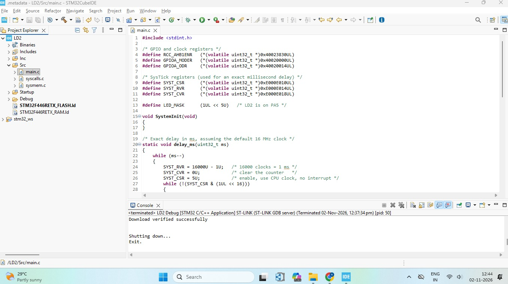

# 💡 STM32 Bare-Metal LED Blink


A bare-metal LED blink project for the **STM32 NUCLEO-F446RE** that controls the on-board LED (**LD2 on PA5**) using **only bitwise operators and direct register access**. It uses no CubeMX, no HAL and no LL drivers, so the code shows exactly what happens inside the microcontroller.

---

## 📌 Overview

This project demonstrates the four fundamental bitwise operations on a GPIO output register:

| Step | Operation | Operator | Result |
|------|-----------|----------|--------|
| 1 | **SET** a bit | `\|=` | LED ON for 4 s |
| 2 | **CLEAR** a bit | `&= ~` | LED OFF for 4 s |
| 3 | **TOGGLE** a bit | `^=` | Fast blink for about 4 s |
| 4 | **CHECK** a bit | `&` | If still 1, clear it |

The sequence then repeats forever.

---

## 🧰 Hardware & Software

**Hardware**
- STM32 NUCLEO-F446RE development board
- USB cable for power and programming (ST-LINK)

**Software**
- Keil MDK (µVision) with Arm Compiler 6
- STM32F4 Device Family Pack (DFP)

---

## 🔌 Pin Configuration

| Signal | Pin | Description |
|--------|-----|-------------|
| LD2 (green LED) | **PA5** | On-board user LED, active HIGH |

No external wiring is required.

---

## 🧠 How It Works

### 1. Enable the GPIOA clock
```c
RCC_AHB1ENR |= (1UL << 0);
```
Bit 0 of `RCC_AHB1ENR` turns on the clock for GPIOA.

### 2. Configure PA5 as output
```c
GPIOA_MODER &= ~(3UL << (5U * 2U));   // clear bits 11:10
GPIOA_MODER |=  (1UL << (5U * 2U));   // set mode 01 = output
```
Each pin uses 2 bits in `MODER`, so PA5 uses bits 11:10. The value `01` selects general-purpose output.

### 3. Control the LED with bitwise operators
```c
GPIOA_ODR |=  LED_MASK;   // SET    -> LED ON
GPIOA_ODR &= ~LED_MASK;   // CLEAR  -> LED OFF
GPIOA_ODR ^=  LED_MASK;   // TOGGLE -> flip LED state
if (GPIOA_ODR & LED_MASK) // CHECK  -> test the bit
```

### 4. Millisecond delay with SysTick
- Reload value = `16000 - 1`, which gives **1 ms** at the default 16 MHz HSI clock
- `SYST_CSR = 5` enables the timer and selects the CPU clock
- The `COUNTFLAG` bit (bit 16) is polled until the count finishes

### 5. Why 41 toggles?
Starting from OFF, an odd number of toggles leaves the LED ON. The final **CHECK** step then finds the bit still set and clears it, which demonstrates the bit-test operation.

---

## 🗂️ Register Map Used

| Register | Address | Purpose |
|----------|---------|---------|
| `RCC_AHB1ENR` | `0x40023830` | Enable the GPIOA peripheral clock |
| `GPIOA_MODER` | `0x40020000` | Set the PA5 pin mode |
| `GPIOA_ODR` | `0x40020014` | Output data register (LED control) |
| `SYST_CSR` | `0xE000E010` | SysTick control and status |
| `SYST_RVR` | `0xE000E014` | SysTick reload value |
| `SYST_CVR` | `0xE000E018` | SysTick current value |

---

## ✅ Expected Output

| Time | LED behavior |
|------|--------------|
| 0 – 4 s | ON (steady) |
| 4 – 8 s | OFF |
| 8 – 12 s | Fast blinking (100 ms) |
| 12 s | Bit check, LED forced OFF, then repeat |

---

## 💻 main.c



---

## 🎥 Demo Video

[▶️ Watch the demo](https://drive.google.com/file/d/1LonZrCkVO6oZXhlHVtkWKcMQ9GeKCArG/view?usp=drivesdk)

---

## 📚 Key Concepts

- Memory-mapped I/O and direct register access
- Bitwise operators: `|=`, `&= ~`, `^=`, `&`, `<<`
- Read-modify-write on peripheral registers
- GPIO mode configuration through the `MODER` register
- Using the Cortex-M SysTick timer for delays
- Building an embedded project without HAL or CubeMX

---

## 🔮 Future Improvements

- Use the BSRR register for atomic set and reset
- Switch the delay to a SysTick interrupt (non-blocking)
- Raise the system clock to 180 MHz using the PLL
- Add a push button input on PC13

---
